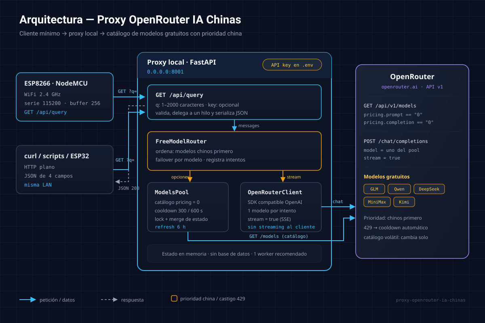
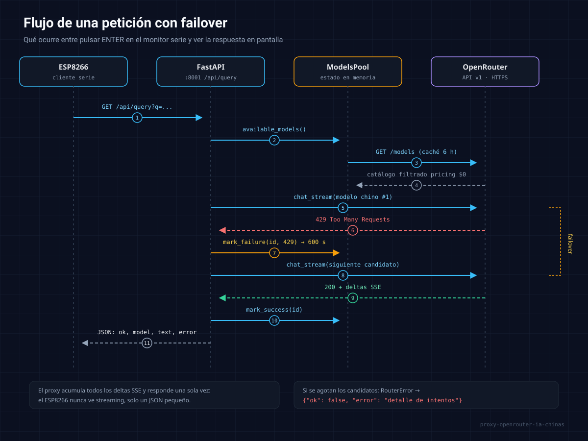
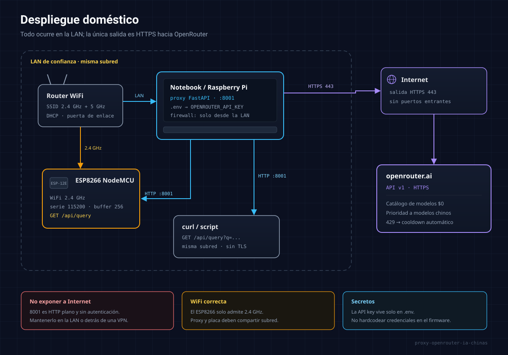

# Proxy OpenRouter IA Chinas

**Una puerta de entrada local, diminuta y honesta a modelos de lenguaje gratuitos.**


Servicio **FastAPI** que corre en tu propia máquina, descubre los modelos cuyo
precio es `$0` en [OpenRouter](https://openrouter.ai), prioriza los modelos de
proveedores chinos y expone un único `GET /api/query` con respuesta JSON
compacta. Lo suficientemente pequeño para que lo consuma un **ESP8266**; lo
suficientemente útil para que lo usen scripts, prototipos y pruebas de
laboratorio.

> **Estado:** proyecto personal, experimental y mantenido sin SLA. Funciona
> mientras OpenRouter mantenga modelos gratuitos. No es un servicio de
> producción ni un sustituto de una API de pago.

---

## Tabla de contenidos

- [1. Qué es este proyecto](#1-qué-es-este-proyecto)
- [2. Por qué existe](#2-por-qué-existe)
- [3. Principio de funcionamiento](#3-principio-de-funcionamiento)
- [4. Arquitectura](#4-arquitectura)
- [5. Estructura del repositorio](#5-estructura-del-repositorio)
- [6. Requisitos](#6-requisitos)
- [7. Instalación](#7-instalación)
- [8. Configuración](#8-configuración)
- [9. API](#9-api)
- [10. Firmware cliente ESP8266](#10-firmware-cliente-esp8266)
- [11. Compilación y carga con arduino-cli](#11-compilación-y-carga-con-arduino-cli)
- [12. Operación](#12-operación)
- [13. Seguridad](#13-seguridad)
- [14. Rendimiento y latencia](#14-rendimiento-y-latencia)
- [15. Solución de problemas](#15-solución-de-problemas)
- [16. Limitaciones](#16-limitaciones)
- [17. Cómo se construyó](#17-cómo-se-construyó)
- [18. Referencias](#18-referencias)
- [19. Licencia](#19-licencia)

---

## 1. Qué es este proyecto

Un **proxy HTTP local** escrito en Python. Recibe una pregunta por query string,
elige un modelo gratuito de OpenRouter, espera la respuesta completa y la
devuelve en un JSON de cuatro campos. No hay interfaz web, no hay base de datos,
no hay streaming hacia el cliente.

La pieza que lo hace distinto es la **política de selección**: en lugar de fijar
un modelo, mantiene un *pool* de todos los modelos cuyo `pricing` es `$0`,
ordena los proveedores chinos primero y aplica *cooldown* a los que fallan. Si
un modelo devuelve `429`, el proxy lo aparta y sigue con el siguiente.

| Es | No es |
|---|---|
| Un proxy local para modelos gratuitos de OpenRouter | Un servidor de inferencia propio |
| Un contrato HTTP mínimo para microcontroladores | Una API multi-tenant con autenticación |
| Un experimento de failover y priorización | Un producto con SLA |
| Una referencia de integración ESP8266 → IA | Un bypass de los límites de OpenRouter |
| Un proyecto de una sola máquina | Un servicio para exponer a Internet |

**Endpoints:**

```
GET /                 → healthcheck informativo
GET /api/query?q=...  → consulta a un modelo gratuito
```

Puerto por defecto: **8001**.

---

## 2. Por qué existe

### 2.1 El problema real

Un ESP8266 tiene 40–80 KB de RAM útil, no valida TLS moderno con comodidad y no
sostiene el SDK de OpenRouter. Pero sí hace muy bien una petición HTTP plana a
la LAN y el parseo de un JSON pequeño.

Al mismo tiempo, OpenRouter ofrece un catálogo cambiante de modelos `$0`. Esos
modelos aparecen y desaparecen, tienen rate limits distintos y a veces
devuelven `429` o `503`. Hardcodear un identificador es una garantía de que en
unas semanas el cliente deje de funcionar.

El proxy resuelve ambas cosas a la vez:

1. **Reduce el contrato** a algo que un microcontrolador puede cumplir.
2. **Absorbe la volatilidad** del catálogo gratuito en el servidor.
3. **Protege la API key**, que nunca llega al dispositivo.
4. **Concentra la lógica** de prioridad y failover en un solo lugar.

### 2.2 Lo que se buscaba

Cliente mínimo (`GET` con dos parámetros y JSON de cuatro claves), coste cero
(filtro estricto de `pricing` igual a `"0"`), prioridad china (proveedores y
keywords), resiliencia (cooldown de 300 s, duplicado a 600 s tras `429`), bajo
mantenimiento (catálogo dinámico), diagnóstico simple (un log por intento) y
reproducibilidad (orden alfabético dentro de cada grupo).

---

## 3. Principio de funcionamiento

### 3.1 El pool de modelos gratuitos

Al primer uso (y cada `POOL_REFRESH_SECONDS`, por defecto 6 horas), el proxy
consulta:

```
GET https://openrouter.ai/api/v1/models
Authorization: Bearer <OPENROUTER_API_KEY>
```

Del catálogo conserva solo los modelos que cumplen **ambas** condiciones:

```text
pricing.prompt     == "0"
pricing.completion == "0"
```

La comparación es de **cadenas**: aceptar `0.0000001` como “gratis” sería un
error de facturación. También se descartan:

- alias cuyo id empieza por `~`;
- el router comodín `openrouter/free`;
- modelos de audio/música como Lyria.

Cada modelo guarda estado en memoria: `active`, `backoff`, `fail_count`,
`last_failure` y `cooldown_until`.

### 3.2 Prioridad china

El orden de candidatos es:

```python
sorted(available, key=lambda m: (not m.is_chinese, m.name.lower()))
```

Es decir: primero los modelos detectados como chinos, luego el resto; dentro de
cada grupo, orden alfabético por nombre. La detección combina dos señales:

1. **Proveedor** por subcadena del id o del nombre: `z-ai`, `zhipu`, `minimax`,
   `deepseek`, `qwen`, `alibaba`, `inclusionai`, `moonshot`, `kimi`, `baidu`,
   `tencent`, `hunyuan`, `stepfun`, `01-ai`, `iflytek`, `sensetime`, `doubao`,
   `baichuan`, `internlm`.
2. **Keyword** en el nombre con límite de palabra: `glm`, `qwen`, `deepseek`,
   `minimax`, `kimi`, `hunyuan`, `doubao`, `internlm`, `baichuan`.

El límite de palabra evita falsos positivos como `ling` dentro de `inkling`.
No es una taxonomía perfecta: es una heurística declarada y mantenible.

### 3.3 Failover y cooldown

Para cada consulta:

1. Se obtienen los modelos sin cooldown activo.
2. Se ordenan según la política anterior.
3. Se intenta el primero. Si responde, se marca éxito y se devuelve.
4. Si falla, se marca el motivo y se pasa al siguiente.
5. Si se agotan, se lanza `RouterError` con el detalle de todos los intentos.

Castigos:

| Situación | Cooldown |
|---|---|
| `429` rate limit | `BACKOFF_SECONDS × 2` (600 s por defecto) |
| Error HTTP distinto de 429 | `BACKOFF_SECONDS` (300 s) |
| Error de conexión | `BACKOFF_SECONDS` |
| Error inesperado | `BACKOFF_SECONDS` |

Un modelo castigado no se intenta hasta que expire su ventana. Al volver, si
falla otra vez, se le aplica un nuevo cooldown.

> **Matiz honesto:** el failover envuelve la creación del generador, no su
> iteración: un error que aparece al abrir el stream puede escapar. Está
> documentado en
> [`docs/developer.md`](docs/developer.md#81-el-failover-no-cubre-errores-durante-la-iteración)
> y en la bitácora. No se oculta: es la deuda funcional principal.

### 3.4 Respuesta

El proxy acumula los fragmentos del stream y responde una sola vez:

```json
{"ok": true, "model": "proveedor/modelo:free", "text": "respuesta", "error": null}
```

Si algo falla:

```json
{"ok": false, "model": null, "text": null, "error": "detalle"}
```

El código HTTP es `200` en ambos casos; el resultado lógico viaja en `ok`. Los
errores de validación de FastAPI sí usan `422`.

---

## 4. Arquitectura

### 4.1 Vista de bloques



*Diagrama editable en [`docs/assets/architecture.svg`](docs/assets/architecture.svg).*

### 4.2 Flujo proxy → OpenRouter

1. `server.py` lee `.env` y crea pool, cliente y router con la misma key.
2. La primera consulta descarga el catálogo (timeout 30 s), filtra los `$0` y
   clasifica cada modelo.
3. El router pide los disponibles, ordena y abre un stream con el primero.
4. El cliente OpenAI recibe SSE y el proxy concatena los `delta.content`.
5. Se serializa el JSON y se cierra la petición.

El catálogo se conserva en memoria. Los modelos que ya existían mantienen su
estado (cooldown, contador) al refrescar; los nuevos entran limpios.

### 4.3 Flujo ESP8266 → proxy

1. El sketch conecta a WiFi **2.4 GHz** y espera una línea por el puerto serie.
2. Al pulsar ENTER, codifica la pregunta con `urlencode()`.
3. Hace `GET http://<SERVER_IP>:8001/api/query?q=...` con timeout de 30 s.
4. Parsea el JSON con ArduinoJson en un buffer de 8 KB.
5. Imprime `Modelo:` y el texto, o el error.

El ESP8266 **no habla con OpenRouter**: no conoce la key, no negocia TLS y no
necesita RAM para el catálogo.

### 4.4 Flujo completo con failover



*Diagrama editable en [`docs/assets/request-flow.svg`](docs/assets/request-flow.svg).*

### 4.5 Despliegue doméstico



*Diagrama editable en [`docs/assets/deployment.svg`](docs/assets/deployment.svg).*

La topología asume:

- un router con red **2.4 GHz** (la ESP8266 no ve 5 GHz);
- el proxy en una notebook o Raspberry Pi con salida HTTPS;
- ambos en la **misma subred**;
- ningún puerto entrante desde Internet.

---

## 5. Estructura del repositorio

```text
proxy-openrouter-ia-chinas/
├── server.py                     # App FastAPI: / y /api/query
├── src/
│   ├── __init__.py
│   ├── models_pool.py            # Catálogo, filtro $0, estado y cooldown
│   ├── openrouter_client.py      # Cliente OpenAI-compatible (stream)
│   └── router.py                 # Prioridad china + failover
├── firmware_esp8266/
│   └── mega_free_chat_8266/
│       └── mega_free_chat_8266.ino
├── docs/
│   ├── datasheet.md              # Manual de usuario/operador
│   ├── developer.md              # Arquitectura, firmas y extensión
│   ├── firmware_esp8266.md       # Guía del cliente
│   ├── REFERENCES.md             # Enlaces oficiales
│   ├── BITACORA.md               # Decisiones y lecciones
│   └── assets/                   # Diagramas SVG
├── requirements.txt
├── run.sh
├── .env.example
├── LICENSE
└── README.md
```

`server.py` valida y serializa; `models_pool.py` es la única fuente de verdad del
catálogo; `router.py` decide el orden y el failover; `openrouter_client.py` es un
adaptador fino sobre el SDK; `run.sh` arranca en primer plano.

---

## 6. Requisitos

### 6.1 Servidor

Python 3.9+ (probado con 3.12), ~100 MB de RAM libre, salida HTTPS a
`openrouter.ai`, una API key de OpenRouter y el puerto `8001` libre. No se
necesita GPU, Docker ni base de datos.

### 6.2 Cliente microcontrolador (opcional)

ESP8266 NodeMCU v3 / ESP-12E (o ESP32 adaptando el sketch), WiFi **2.4 GHz**,
cable USB de datos, `arduino-cli` con core `esp8266` y `ArduinoJson`, y monitor
serie a 115200 baudios con terminal UTF-8.

### 6.3 Dependencias de Python

Están declaradas en `requirements.txt`:

```text
fastapi
uvicorn[standard]
openai
httpx
python-dotenv
```

No hay versiones fijadas. Eso mantiene el proyecto al día, pero hace que dos
instalaciones en fechas distintas no sean idénticas. Para un despliegue serio,
genera un lock:

```bash
pip freeze > requirements.lock
```

---

## 7. Instalación

### 7.1 Clonar

```bash
git clone https://github.com/wanderc137/proxy-openrouter-ia-chinas.git
cd proxy-openrouter-ia-chinas
```

### 7.2 Entorno virtual e instalación exacta

Las dependencias están en `requirements.txt`. Los comandos exactos son:

```bash
python3 -m venv venv
source venv/bin/activate        # Linux/Mac
venv\Scripts\activate           # Windows
pip install -r requirements.txt
```

> `run.sh` usa `.venv` (con punto). Ambos nombres funcionan; sé consistente y
> activa el entorno antes de ejecutar `python server.py`.

Instalación recomendada con `.venv`, que es la que espera `run.sh`:

```bash
python3 -m venv .venv
source .venv/bin/activate
python -m pip install --upgrade pip
pip install -r requirements.txt
```

Verificación:

```bash
python -c "import fastapi, uvicorn, openai, httpx, dotenv; print('dependencias ok')"
```

### 7.3 Configurar la clave

```bash
cp .env.example .env
```

Edita `.env`:

```dotenv
OPENROUTER_API_KEY=sk-or-v1-...
BACKOFF_SECONDS=300
POOL_REFRESH_SECONDS=21600
DEBUG=false
```

Restringe permisos:

```bash
chmod 600 .env
```

La clave se crea en <https://openrouter.ai/keys>. No necesitas crédito para los
modelos `$0`, pero sí una cuenta válida.

### 7.4 Arrancar

**Opción A — script en primer plano (recomendada):**

```bash
./run.sh
```

`run.sh` crea `.venv`, instala dependencias si falta `uvicorn`, copia
`.env.example`, valida la key y ejecuta `server.py`. Se detiene con **Ctrl+C** y
no deja procesos en segundo plano.

**Opción B — Uvicorn directo:**

```bash
source .venv/bin/activate
uvicorn server:app --host 0.0.0.0 --port 8001
```

**Opción C — Python directo:**

```bash
source .venv/bin/activate
python server.py
```

### 7.5 Verificar

```bash
curl -s http://localhost:8001/
```

```json
{
  "name": "proxy-openrouter-ia-chinas",
  "version": "1.0.0",
  "uso": "/api/query?q=<pregunta>[&key=sk-or-v1-...]"
}
```

Ese endpoint **no** comprueba OpenRouter; solo dice que el proceso está vivo.
Para una prueba real:

```bash
curl -s "http://localhost:8001/api/query?q=hola"
```

### 7.6 Errores típicos de instalación

| Síntoma | Causa | Solución |
|---|---|---|
| `ModuleNotFoundError: fastapi` | Entorno no activado | `source .venv/bin/activate` |
| `Address already in use` | Puerto 8001 ocupado | `ss -ltnp \| grep 8001` |
| `ERROR: OPENROUTER_API_KEY no configurada` | `.env` ausente o placeholder | Editar `.env` |
| `SSL: CERTIFICATE_VERIFY_FAILED` | Proxy/VPN con inspección TLS | Red sin interceptación o CA correcta |

---

## 8. Configuración

### 8.1 Variables de entorno

| Variable | Obligatoria | Default | Descripción |
|---|---|---|---|
| `OPENROUTER_API_KEY` | Sí | — | Clave usada por el pool y el cliente |
| `BACKOFF_SECONDS` | No | `300` | Cooldown base por fallo; `429` lo duplica |
| `POOL_REFRESH_SECONDS` | No | `21600` | Intervalo de recarga del catálogo (6 h) |
| `DEBUG` | No | `false` | Logs de nivel DEBUG |
| `OR_BASE_URL` | No | `https://openrouter.ai/api/v1` | Base URL; permite apuntar a un mock |

`OR_BASE_URL` se lee en `models_pool.py` y `openrouter_client.py` **al
importar**. Cambiarla después de arrancar no tiene efecto.

`DEBUG` en `.env.example` aparece como `true`, pero el default del código es
`false`. Si quieres logs detallados, déjalo en `true`; si no, cámbialo.

### 8.2 Ejemplo de `.env` con placeholders

```dotenv
# Nunca subas este archivo al repositorio
OPENROUTER_API_KEY=sk-or-v1-...
BACKOFF_SECONDS=300
POOL_REFRESH_SECONDS=21600
DEBUG=false

# Opcional, para pruebas con un servidor falso
# OR_BASE_URL=http://127.0.0.1:9000/api/v1
```

### 8.3 Puerto

| Dónde | Valor | Cómo cambiarlo |
|---|---|---|
| `server.py` | `8001` | Editar `uvicorn.run(...)` |
| `run.sh` | `${PORT:-8001}` | `PORT=9000 ./run.sh` |
| Firmware | `SERVER_PORT = 8001` | Editar y recompilar |
| Uvicorn CLI | `--port 8001` | Parámetro al arrancar |

Si cambias el puerto del servidor y no el del firmware, el ESP8266 recibirá
`connection refused` o un timeout.

### 8.4 Logs

```text
INFO mega_free_chat.router: Intentando con modelo gratuito: ...
WARNING mega_free_chat.router: Modelo ... con rate limit, probando siguiente
INFO mega_free_chat.pool: Pool actualizado: N modelos gratuitos disponibles
```

No se imprime la API key; sí ids de modelo y errores del upstream.

---

## 9. API

### 9.1 `GET /`

Healthcheck informativo.

**Respuesta `200`:**

```json
{
  "name": "proxy-openrouter-ia-chinas",
  "version": "1.0.0",
  "uso": "/api/query?q=<pregunta>[&key=sk-or-v1-...]"
}
```

### 9.2 `GET /api/query`

| Parámetro | Tipo | Obligatorio | Límites | Descripción |
|---|---|---|---|---|
| `q` | string | Sí | 1–2000 caracteres | Pregunta en texto plano |
| `key` | string | No | — | API key de OpenRouter; si falta se usa `.env` |

**Respuesta de éxito (`200`):**

```json
{
  "ok": true,
  "model": "proveedor/modelo:free",
  "text": "La respuesta completa del modelo.",
  "error": null
}
```

**Fallo lógico (`200`):**

```json
{
  "ok": false,
  "model": null,
  "text": null,
  "error": "No hay ningún modelo gratuito disponible en este momento."
}
```

**Validación (`422`):** cuerpo estándar de FastAPI, con `detail` y la lista de
errores. Ocurre si `q` falta, está vacío o supera 2000 caracteres.

#### Contrato de respuesta

| Campo | Tipo | Éxito | Fallo |
|---|---|---|---|
| `ok` | boolean | `true` | `false` |
| `model` | string \| null | id del modelo | `null` |
| `text` | string \| null | respuesta completa | `null` |
| `error` | string \| null | `null` | detalle legible |

El cliente debe mirar `ok`, no el código HTTP. Un `200` con `ok:false` es una
respuesta normal del proxy, no un error de transporte.

#### Semántica de `key`

- Sin `key`, se usa `OPENROUTER_API_KEY` del `.env` y el pool global.
- Con `key`, se crea un pool y un cliente **nuevos para esa petición**. Eso
  implica descargar el catálogo otra vez (hasta 30 s de timeout) y no compartir
  cooldowns.
- La clave viaja en la URL: queda en historial, logs y proxies. Úsala solo para
  pruebas puntuales.

### 9.3 Ejemplos con curl

```bash
# Consulta simple
curl -s "http://localhost:8001/api/query?q=que+es+un+resistor"

# Texto con acentos y signos (percent-encoding)
curl -s --get "http://localhost:8001/api/query" \
  --data-urlencode "q=¿Qué diferencia hay entre un MOSFET y un BJT?"

# Desde otro equipo de la LAN
curl -s "http://192.0.2.10:8001/api/query?q=hola"

# Key explícita (solo pruebas)
curl -s "http://192.0.2.10:8001/api/query?q=hola&key=sk-or-v1-..."
```

### 9.4 Ejemplo con Python (solo biblioteca estándar)

```python
import json
import urllib.parse
import urllib.request

BASE = "http://192.0.2.10:8001/api/query"
question = "Explica qué es un optoacoplador en dos frases."

url = BASE + "?" + urllib.parse.urlencode({"q": question})
with urllib.request.urlopen(url, timeout=60) as resp:
    data = json.load(resp)

if data["ok"]:
    print(f"[{data['model']}] {data['text']}")
else:
    print("Error:", data["error"])
```

### 9.5 Ejemplo con JavaScript

```javascript
const url = new URL("http://192.0.2.10:8001/api/query");
url.searchParams.set("q", "¿Qué es un PWM?");

const res = await fetch(url, { signal: AbortSignal.timeout(60000) });
const data = await res.json();

if (data.ok) {
  console.log(`Modelo: ${data.model}`);
  console.log(data.text);
} else {
  console.error(`Fallo: ${data.error}`);
}
```

### 9.6 Ejemplo mínimo en el ESP8266

El patrón es: `http.begin(client, url)`, `http.GET()`, `http.getString()` y
`deserializeJson(doc, payload)` con un `DynamicJsonDocument(8192)`. El sketch
completo y comentado está en
[`firmware_esp8266/mega_free_chat_8266`](firmware_esp8266/mega_free_chat_8266).

---

## 10. Firmware cliente ESP8266

### 10.1 Qué hace

Convierte una NodeMCU en un **terminal serie**:

1. Conecta a una red WiFi de **2.4 GHz**.
2. Lee caracteres del puerto serie hasta `\n`.
3. Codifica la pregunta y llama al proxy.
4. Parsea el JSON y muestra modelo + texto, o el error.
5. Si pierde WiFi, reintenta cada 15 s.

No tiene pantalla, ni botones, ni sensores. Solo USB, WiFi y consola serie.

### 10.2 Pinout utilizado

La placa se alimenta y se comunica **solo por el cable USB**. No hay cableado
externo obligatorio. Esta tabla documenta el uso real de cada pin relevante:

| Pin NodeMCU | GPIO | Uso en este proyecto | Notas |
|---|---|---|---|
| `Micro-USB` | — | Alimentación 5 V + UART | Único conector necesario |
| `VIN` | — | No usado | Entrada 5 V alternativa |
| `3V3` | — | No usado | Salida 3.3 V, no alimentar desde aquí |
| `GND` | — | No usado externamente | Referencia común si se añade hardware |
| `EN` | — | No usado | Pull-up en la placa |
| `RST` | — | No usado | Reset por botón |
| `GPIO0` | 0 | No usado | A GND para modo flash; no forzar en runtime |
| `GPIO1` | TXD | UART TX hacia el CH340 | No conectar otro dispositivo |
| `GPIO3` | RXD | UART RX desde el CH340 | No conectar otro dispositivo |
| `GPIO2` | 2 | No usado | LED de la placa en algunas variantes |
| `GPIO4` | 4 | No usado | Libre |
| `GPIO5` | 5 | No usado | Libre |
| `GPIO12–15` | 12–15 | No usado | Libre |
| `A0` | ADC | No usado | Máximo 1.0 V; requiere divisor |

**Diagrama de conexión (textual):**

```
[PC] ── USB ── [NodeMCU v3]
                  │
                  ├── WiFi 2.4 GHz ──► [Router] ──► [PC con proxy :8001]
                  └── UART interna ──► CH340 ──► monitor serie 115200
```

No se requiere fuente externa, ni level shifter, ni resistencias. Si se
quisiera usar un adaptador UART externo en lugar del USB, habría que conectar
TX↔RX, RX↔TX y GND↔GND a **3.3 V**, nunca a 5 V.

### 10.3 Configuración del sketch

En `mega_free_chat_8266.ino`:

| Constante | Placeholder | Descripción |
|---|---|---|
| `WIFI_SSID` | `"mi-red-2.4g"` | Red **2.4 GHz** |
| `WIFI_PASS` | `"cambia-esto"` | Contraseña |
| `SERVER_IP` | `"192.0.2.10"` | IP local del proxy |
| `SERVER_PORT` | `8001` | Puerto del proxy |
| `SERIAL_BAUD` | `115200` | Baudios del monitor |
| `BUFFER_SIZE` | `256` | Largo máximo de la pregunta |

> **Importante:** el sketch de referencia declara estos valores como constantes
> en el propio `.ino`. Esta documentación no reproduce los valores que pueda
> contener una copia local. Antes de compilar, sustituye los cuatro por los
> tuyos y, antes de publicar un fork, muévelos a un `secrets.h` ignorado por
> git. Ver [13.5](#135-deuda-de-seguridad-en-el-firmware).

### 10.4 Comportamiento en serie

```text
=== Mega Free Chat - ESP8266 ===
Conectando a la red y listo para preguntas.
Escribe una pregunta y pulsa ENTER.

[WiFi] Conectando a mi-red-2.4g
........
[WiFi] Conectado. IP: 192.0.2.937

Pregunta: que es un resistor
[API] Consultando: http://192.0.2.10:8001
[API] HTTP: 200
========================================
Modelo: proveedor/modelo:free
----------------------------------------
Un resistor es un componente pasivo...
========================================
```

Errores esperables:

```text
[WiFi] No se pudo conectar.
[API] Sin conexión WiFi. Reintentando...
[API] Falla de conexión, error: connection refused
[API] Error: No hay ningún modelo gratuito disponible en este momento.
[API] No se pudo parsear JSON.
```

### 10.5 Limitaciones del cliente

Pregunta máxima de **255 caracteres** y respuesta acotada por
`DynamicJsonDocument(8192)`. No hay TLS ni autenticación, la IP del servidor es
fija (si cambia por DHCP hay que recompilar) y la entrada es solo texto plano.

---

## 11. Compilación y carga con arduino-cli

### 11.1 Instalar el core y la librería

```bash
arduino-cli core update-index
arduino-cli core install esp8266:esp8266
arduino-cli lib install ArduinoJson
```

Verificar:

```bash
arduino-cli core list
arduino-cli lib list | grep -i arduinojson
```

### 11.2 Detectar la placa

```bash
arduino-cli board list
```

El puerto puede ser `/dev/ttyUSB0` (CH340/CP2102) o `/dev/ttyACM0` (CDC). **No
lo hardcodees**: usa el que devuelva el comando.

### 11.3 Compilar

```bash
cd firmware_esp8266
arduino-cli compile --fqbn esp8266:esp8266:nodemcuv2 mega_free_chat_8266
```

| FQBN | Cuándo usarlo |
|---|---|
| `esp8266:esp8266:nodemcuv2` | NodeMCU v2/v3 con ESP-12E y 4 MB (recomendado) |
| `esp8266:esp8266:nodemcu` | Variantes antiguas de 512 KB |
| `esp8266:esp8266:generic` | Módulos genéricos; ajustar flash y CPU |

Si el core solo expone `nodemcu`, usa ese. La diferencia práctica está en la
distribución de flash y en el tamaño máximo del sketch.

### 11.4 Cargar

```bash
arduino-cli upload \
  --fqbn esp8266:esp8266:nodemcuv2 \
  --port /dev/ttyUSB0 \
  mega_free_chat_8266
```

Cierra cualquier monitor serie antes de subir; el puerto queda ocupado.

### 11.5 Abrir el monitor

```bash
# Opción 1: arduino-cli
arduino-cli monitor --port /dev/ttyUSB0 --config baudrate=115200

# Opción 2: picocom (UTF-8 correcto)
picocom -b 115200 /dev/ttyUSB0
# Salir: Ctrl+A, luego Ctrl+X
```

### 11.6 Problemas de compilación/carga

| Síntoma | Causa | Solución |
|---|---|---|
| `Platform 'esp8266' not found` | Core no instalado | `arduino-cli core install esp8266:esp8266` |
| `ArduinoJson.h: No such file` | Librería no instalada | `arduino-cli lib install ArduinoJson` |
| `Sketch too big` | FQBN con flash pequeño | Usar `nodemcuv2` |
| `Failed to connect to ESP8266` | Placa no en modo boot o cable malo | Mantener FLASH, probar otro cable/puerto |
| `Permission denied: /dev/ttyUSB0` | Grupo `dialout` | `sudo usermod -aG dialout $USER` y relogin |
| Puerto desaparece | Driver CH340 o cable | Revisar `dmesg`, probar otro cable |
| `error: espcomm_open failed` | Monitor serie abierto | Cerrar picocom/IDE |

---

## 12. Operación

Ciclo diario: arrancar el proxy, comprobar `GET /` y una consulta, encender la
placa, preguntar y, al terminar, **Ctrl+C** en la terminal del proxy.

```bash
# Proceso vivo (no valida OpenRouter)
curl -sf http://localhost:8001/ >/dev/null && echo "proxy ok"

# Consulta funcional (consume cuota)
curl -s "http://localhost:8001/api/query?q=ping" | python3 -m json.tool
```

En los logs, `Intentando con modelo gratuito` muestra el orden de intentos;
`rate limit` o `HTTP 429` indican un modelo castigado; `Pool actualizado`
confirma el catálogo; `No se pudo actualizar el pool` apunta a red o API; y
`Error interno` es una excepción no controlada. No hay endpoint de métricas;
`to_payload()` existe si quieres exponer uno.

Actualizar es `git pull`, `pip install -r requirements.txt` y reiniciar; no hay
migraciones ni estado que conservar.

---

## 13. Seguridad

### 13.1 Modelo de amenaza

El diseño asume una **red doméstica de confianza**. Los riesgos reales, en
orden de impacto, son: exponer el puerto a Internet (consumo de cuota ajeno),
filtrar la API key en `.env`, en la URL o en el firmware, permitir que cualquier
dispositivo de la LAN consulte sin autenticación, y abusar de los rate limits
con reintentos agresivos.

### 13.2 Checklist mínima

- [ ] `.env` con `chmod 600` y fuera de git.
- [ ] Puerto `8001` cerrado desde el router (sin *port forwarding*).
- [ ] Firewall del host limitado a la subred local.
- [ ] API key rotada si alguna vez estuvo en un commit.
- [ ] Firmware sin credenciales reales en el repositorio.
- [ ] `DEBUG=false` en uso normal.
- [ ] Logs revisados antes de compartirlos (pueden contener ids y errores).
- [ ] Una sola instancia/worker para que los cooldowns sean coherentes.

### 13.3 API key

Key dedicada al proyecto, con límites de gasto, rotada cada 90 días o ante
sospecha. No pasarla por `key` salvo en pruebas locales, no imprimirla en logs
ni incluirla en capturas. La mala práctica concreta es
`curl "...?q=hola&key=sk-or-v1-..."`: queda en el historial del shell.

### 13.4 Red local

El servicio escucha en `0.0.0.0:8001`, lo que incluye todas las interfaces.
Opciones para reducirlo:

```bash
# Solo loopback
uvicorn server:app --host 127.0.0.1 --port 8001
```

Con `ufw`: `sudo ufw allow from 192.0.2.0/24 to any port 8001 proto tcp` y
`sudo ufw deny 8001/tcp`. No expongas el servicio a Internet; si necesitas
acceso remoto, usa una VPN y autenticación delante del proxy.

### 13.5 Deuda de seguridad en el firmware

El sketch de referencia declara `WIFI_SSID`, `WIFI_PASS` y `SERVER_IP` como
constantes. Para un repositorio público eso es deuda técnica:

1. Crear `secrets.h` con los valores reales.
2. Añadirlo a `.gitignore`.
3. Publicar `secrets.example.h` con placeholders.
4. Incluirlo con `#include "secrets.h"`.

Esta documentación **no** reproduce credenciales, SSIDs ni IPs reales. Si tu
copia del repositorio contiene valores reales, considéralos comprometidos y
cámbialos.

### 13.6 Términos de uso

Usa solo rutas públicas `$0` con una key propia: no evade rate limits, no rota
claves ni automatiza cuentas. Si OpenRouter elimina el free tier, el proyecto se
queda sin modelos.

---

## 14. Rendimiento y latencia

### 14.1 De qué depende

La latencia de una consulta se compone de:

| Etapa | Qué aporta | Cómo varía |
|---|---|---|
| Resolución DNS + TLS a OpenRouter | Primer salto de red | Red, VPN, DNS, reutilización de conexión |
| Descarga del catálogo | Primera consulta o refresco | ~30 s de timeout máximo; tamaño del JSON |
| Cola del modelo gratuito | Trabajo del proveedor | Hora del día, popularidad, rate limits |
| Generación | Tokens de salida | Longitud de la respuesta |
| Acumulación en el proxy | Copia de fragmentos | Tamaño total de la respuesta |
| Transporte al cliente | LAN | WiFi 2.4 GHz, distancia, interferencia |

**No publicamos números concretos** porque dependen del modelo elegido, del
momento y de la carga de OpenRouter. Cualquier cifra fija sería inventada o
quedaría obsoleta en días.

### 14.2 Cómo medirlo en tu entorno

```bash
# Tiempo total de una consulta (incluye red y generación)
curl -s -o /tmp/resp.json -w "total: %{time_total}s\n" \
  "http://localhost:8001/api/query?q=responde+con+una+frase"

# Tiempo del healthcheck (sin upstream)
curl -s -o /dev/null -w "health: %{time_total}s\n" http://localhost:8001/
```

```python
import time, urllib.request

t0 = time.perf_counter()
with urllib.request.urlopen("http://localhost:8001/api/query?q=hola", timeout=90) as r:
    body = r.read()
print(f"{(time.perf_counter() - t0) * 1000:.0f} ms, {len(body)} bytes")
```

Mide varias veces y a distintas horas; la primera consulta incluye la descarga
del catálogo, no la mezcles con la media.

### 14.3 Palancas de ajuste

| Palanca | Efecto | Riesgo |
|---|---|---|
| `POOL_REFRESH_SECONDS` alto | Menos descargas de catálogo | Modelos nuevos tardan en entrar |
| `BACKOFF_SECONDS` bajo | Vuelve antes a modelos castigados | Insistir en un `429` y empeorar |
| `BACKOFF_SECONDS` alto | Menos reintentos inútiles | Menos candidatos disponibles |
| Un solo worker | Estado coherente | Menos paralelismo |
| `key` en `.env` | Evita crear pools efímeros | Ninguno, es la ruta recomendada |

### 14.4 Timeouts

El catálogo usa 30 s (`httpx.Client(timeout=30)`) y el firmware también 30 s
(`http.setTimeout(30000)`). Si el cliente corta antes que el proxy, la respuesta
se pierde aunque el modelo haya terminado: usa 60–90 s en scripts.

---

## 15. Solución de problemas

### 15.1 WiFi: 5 GHz vs 2.4 GHz

**El síntoma más común.** La ESP8266 solo soporta 2.4 GHz: si el SSID termina
en `5G` o el router separa bandas, no verá la red.

| Síntoma | Diagnóstico | Solución |
|---|---|---|
| `[WiFi] No se pudo conectar.` | SSID de 5 GHz o clave incorrecta | Usar el SSID de 2.4 GHz |
| La red no aparece en un escaneo | Banda no soportada | Activar banda 2.4 GHz en el router |
| Conecta pero no llega al proxy | Subredes distintas | Unificar subred o abrir el puerto |
| Conexión intermitente | Interferencia 2.4 GHz | Cambiar canal; acercar la placa |

No hay forma de “habilitar 5 GHz” por software: es una limitación del chip.

### 15.2 `429 Too Many Requests`

| Causa | Qué hacer |
|---|---|
| Cuota gratuita agotada para ese modelo | Esperar el cooldown (600 s) |
| Muchas consultas seguidas | Bajar frecuencia; no paralelizar |
| Modelo popular saturado | Dejar que el failover elija otro |

El proxy ya aplica cooldown doble. Si **todos** los modelos devuelven 429, la
respuesta será `ok:false` con el detalle. No hay magia: hay que esperar o
reducir el uso.

### 15.3 No hay modelos gratuitos

| Causa | Verificación |
|---|---|
| El catálogo no tiene `pricing` en `"0"` | Abrir <https://openrouter.ai/models?max_price=0> |
| Cambió el formato de precios | Revisar `GET /api/v1/models` |
| El filtro descartó todos por no ser chat | Revisar ids `~`, `openrouter/free`, `lyria` |
| Falla la descarga del catálogo | Ver logs `No se pudo actualizar el pool` |

Si el pool queda vacío, `available_models()` devuelve `[]` y el router lanza
`RouterError("No hay ningún modelo gratuito disponible en este momento.")`.

### 15.4 Errores de autenticación

| Mensaje | Causa | Fix |
|---|---|---|
| `No auth credentials found` | Key vacía o inválida | Revisar `.env` |
| `401` | Key revocada | Crear una nueva |
| `402` | Se intentó un modelo de pago | Revisar el filtro; no debería ocurrir |
| `403` | Restricción de cuenta/región | Revisar la cuenta en OpenRouter |

### 15.5 Conectividad

| Síntoma | Causa | Fix |
|---|---|---|
| `connection refused` | Proxy apagado o puerto distinto | Arrancar; verificar `8001` |
| `Timeout` | Firewall, subred o upstream lento | `curl` desde el servidor; revisar firewall |
| `Name or service not known` | DNS | Probar `curl https://openrouter.ai` |
| `SSL: CERTIFICATE_VERIFY_FAILED` | Inspección TLS/VPN | Red sin interceptación o CA correcta |
| Funciona en localhost, no en LAN | Bind a `127.0.0.1` o firewall | `--host 0.0.0.0`; abrir puerto local |

### 15.6 Respuestas y parseo

| Síntoma | Causa | Fix |
|---|---|---|
| `No se pudo parsear JSON` | Respuesta > 8 KB o HTML de error | Subir buffer; revisar payload |
| `ok:false` con `Error interno` | Excepción del SDK (ver 16.1) | Revisar logs; reintentar |
| Texto cortado | Timeout del cliente | Subir timeout |
| Acentos raros en serie | Terminal Latin-1 | Usar UTF-8 (picocom) |
| `422` | `q` vacío o > 2000 | Ajustar la pregunta |

### 15.7 Puerto y procesos

```bash
# ¿Quién ocupa 8001?
ss -ltnp | grep 8001

# ¿Quedó un proceso viejo?
pgrep -af "server.py|uvicorn"

# Matar solo el proceso identificado
kill <PID>
```

`run.sh` no deja daemons. Si aparece un proceso en segundo plano, lo lanzó otra
herramienta o una ejecución manual con `&`.

---

## 16. Limitaciones

### 16.1 Failover parcial (la más importante)

`OpenRouterClient.chat_stream` es un generador. La petición HTTP ocurre en el
primer `next()`, no al crear el generador. `FreeModelRouter.stream` captura
errores al crear el stream y marca éxito de inmediato; si el `429` aparece al
abrir la conexión, se propaga como `Error interno` y **no** se prueba el
siguiente modelo ni se aplica cooldown.

Consecuencia práctica: el failover funciona para fallos tempranos del SDK, pero
no está garantizado para todos los errores de streaming. Es la deuda funcional
documentada en [`docs/BITACORA.md`](docs/BITACORA.md) y
[`docs/developer.md`](docs/developer.md).

### 16.2 Sin autenticación ni TLS

Cualquiera en la LAN puede usar el proxy y consumir tu cuota. El tráfico entre
el ESP8266 y el proxy va en HTTP plano. No lo expongas a Internet.

### 16.3 Sin conversación multi-turno

Cada request envía un único mensaje `user`. No hay memoria, ni `system prompt`
configurable, ni historial. El modelo no recuerda la pregunta anterior.

### 16.4 Sin streaming hacia el cliente

El proxy acumula toda la respuesta. El cliente espera y recibe un JSON único.
Es intencional para el ESP8266, pero implica más latencia percibida y más RAM
en el servidor para respuestas largas.

### 16.5 Catálogo volátil

Los modelos `$0` son promociones: pueden desaparecer o empezar a cobrar. El
proxy se adapta a lo que haya, pero no garantiza que exista al menos uno.

### 16.6 Prioridad china heurística

Se basa en subcadenas y keywords. Un proveedor nuevo no listado no se prioriza;
un nombre con `kimi` en un modelo no chino sí. Actualizar las listas es
mantenimiento manual.

### 16.7 Estado por proceso

Cooldowns y catálogo viven en RAM; reiniciar los borra y varios workers tienen
estados incoherentes.

### 16.8 `key` por query string y pool efímero

Cada llamada con `key` crea un pool nuevo y descarga el catálogo. Es cómodo para
probar, caro para producir. Además, la clave queda en la URL.

### 16.9 Errores con HTTP 200 y credenciales en el firmware

El proxy usa `ok` para el resultado lógico; un cliente que solo mire el status
creerá que todo fue bien. Además, el `.ino` declara SSID, contraseña e IP como
constantes: deuda de seguridad para un repo público (ver
[13.5](#135-deuda-de-seguridad-en-el-firmware)).

### 16.10 Calidad y reproducibilidad

Sin tests ni métricas: la validación es manual. `requirements.txt` no fija
versiones, así que una actualización mayor puede cambiar el comportamiento sin
aviso. Aceptable para portfolio; insuficiente para producción.

---

## 17. Cómo se construyó

### 17.1 Decisiones clave

| Decisión | Alternativa descartada | Por qué |
|---|---|---|
| `GET` con query string | `POST` con JSON | Menos cabeceras y cuerpo en el MCU |
| JSON de 4 campos | JSON crudo de OpenRouter | Menos RAM y parseo trivial |
| Catálogo dinámico | Lista fija de modelos | Los `$0` cambian en días |
| Filtro `== "0"` | `<= 0` numérico | Evita modelos de pago “casi gratis” |
| Prioridad china | Orden arbitrario | Objetivo explícito del proyecto |
| Cooldown 2× en 429 | Reintento inmediato | No empeorar el rate limit |
| Estado en memoria | Base de datos | Estado volátil, sin migraciones |
| Primer plano (`run.sh`) | Lanzador dock on/off | Ciclo de vida visible y simple |
| Puerto 8001 | Compartir 8000 con la UI | Convivencia sin coordinación |

La historia completa, incluidos los enfoques descartados y las deudas, está en
[`docs/BITACORA.md`](docs/BITACORA.md).

### 17.2 Iteraciones reales

Commit inicial con proxy, pool, router y firmware; un lanzador de dock
revertido en favor de `run.sh`; la prueba física que reveló el problema de
5 GHz; y la fase de documentación.

### 17.3 Stack

| Capa | Tecnología | Rol |
|---|---|---|
| Servidor | Python 3.9+ | Lenguaje |
| Framework | FastAPI | Endpoint y validación |
| Servidor ASGI | Uvicorn | Ejecución |
| Cliente upstream | SDK de OpenAI | Streaming compatible |
| Catálogo | httpx | `GET /models` |
| Config | python-dotenv | `.env` |
| Firmware | C++ / Arduino | Cliente ESP8266 |
| WiFi/HTTP | core ESP8266 | Red y transporte |
| JSON | ArduinoJson | Parseo en el MCU |
| Diagramas | SVG a mano | Documentación |

---

## 18. Referencias

Documentación interna:

- [`docs/datasheet.md`](docs/datasheet.md) — manual de usuario y operador.
- [`docs/developer.md`](docs/developer.md) — arquitectura, módulos y extensión.
- [`docs/firmware_esp8266.md`](docs/firmware_esp8266.md) — guía del cliente.
- [`docs/BITACORA.md`](docs/BITACORA.md) — decisiones y lecciones.
- [`docs/REFERENCES.md`](docs/REFERENCES.md) — enlaces oficiales comentados.
- [`docs/assets/`](docs/assets/) — diagramas SVG.

Fuentes principales: [documentación de OpenRouter](https://openrouter.ai/docs),
[catálogo con filtro `$0`](https://openrouter.ai/models?max_price=0),
[gestión de claves](https://openrouter.ai/keys), [FastAPI](https://fastapi.tiangolo.com/),
[Uvicorn](https://www.uvicorn.org/), [SDK de OpenAI](https://github.com/openai/openai-python),
[ArduinoJson](https://arduinojson.org/), [core ESP8266](https://github.com/esp8266/Arduino)
y [Arduino CLI](https://arduino.github.io/arduino-cli/).

---

## 19. Licencia

MIT. Ver [`LICENSE`](LICENSE).

```text
Copyright (c) 2026 wanderc137
```

El software se ofrece “tal cual”, sin garantía. El uso de OpenRouter está sujeto
a sus propios términos y a la disponibilidad de modelos gratuitos. Este
proyecto no está afiliado a OpenRouter ni a los proveedores de modelos
mencionados.

---

<p align="center">
  <sub>Hecho para entender qué pasa entre pulsar ENTER en un ESP8266 y recibir una respuesta.</sub>
</p>

## Ficha de evaluación

**Madurez global: 3.7/5**

| Criterio | Nota | Evidencia |
|---|---:|---|
| Madurez | 3/5 | Dos endpoints, pool con cooldown y firmware compilable; sin tests automatizados y con el failover incompleto declarado. |
| Reproducibilidad | 3/5 | Python 3.9+ (probado en 3.12), cuatro dependencias sin pin y puerto 8001; el firmware exige editar WiFi, IP y clave dentro del .ino. |
| Documentación | 4/5 | README de 40 KB, datasheet de 15 KB, developer de 21 KB, guía de firmware y bitácora con tabla de 10 deudas; quedan comentarios que mencionan el puerto 8000 en lugar de 8001. |
| Honestidad de límites | 5/5 | El README advierte en el flujo de failover que el try/except envuelve el generador, y la bitácora lista deuda, impacto y corrección sugerida para cada punto. |
| Valor demostrativo | 4/5 | Contrato de cuatro campos para un cliente de 80 KB de RAM, prioridad por proveedor con regex ancladas y cooldown de 300 s ampliado a 600 s tras 429. |
| Facilidad de despliegue | 3/5 | run.sh en primer plano y .env con la key; el cliente requiere arduino-cli, red 2.4 GHz y credenciales WiFi embebidas en el sketch. |

Sirve para conectar un microcontrolador a un modelo gratuito sin exponer la key ni implementar TLS en el dispositivo. La limitación que más pesa es que el failover no cubre el error al abrir el stream, justo el caso de un 429.

## Lo que no funcionó

### firmware_esp8266 · puesta en marcha — La ESP8266 no veía la red WiFi

La red disponible era de 5 GHz y el ESP8266 solo asocia 2.4 GHz, así que la placa fallaba tras 20 segundos de intentos. Se usó el SSID gemelo de 2.4 GHz en la misma subred y la restricción quedó escrita en el sketch y en la guía del cliente.

### firmware_esp8266 · parseo — El JSON no entraba en el buffer de 8 KB

DynamicJsonDocument(8192) se quedaba corto con respuestas largas en UTF-8 y el sketch reportaba "No se pudo parsear JSON". Se mantuvo el buffer y se aceptaron respuestas moderadas; calcular la capacidad o filtrar max_chars en el servidor quedó pendiente.

### v1.0 · failover — El failover no cubre errores al abrir el stream

El router captura excepciones alrededor de la creación del generador, no de su iteración, de modo que un 429 inicial no dispara cooldown ni cambio de modelo. Está documentado como deuda funcional principal, sin corregir en esta fase.

### v1.0 · operación — Key ausente detectada tarde

El servicio arrancaba y todas las consultas fallaban con 401. run.sh ahora valida el prefijo sk-or-v1- antes de arrancar y server.py emite un WARNING, pero la comprobación es sintáctica y no verifica la clave contra OpenRouter.

## Preguntas típicas

**¿Qué es Proxy OpenRouter IA Chinas?**

Un proxy FastAPI local que elige un modelo gratuito de OpenRouter, prioriza proveedores chinos y devuelve la respuesta en un JSON de cuatro campos consumible por un ESP8266.

**¿Es un servicio listo para producción?**

No. Corre en una LAN doméstica, no tiene autenticación de entrada, no persiste estado y depende de que existan modelos con pricing "0" en OpenRouter.

**¿Cómo se despliega?**

Se instala requirements, se define OPENROUTER_API_KEY en .env y se lanza run.sh en el puerto 8001; el firmware se compila con arduino-cli para esp8266:esp8266:nodemcuv2.

**¿Qué se puede reutilizar?**

El pool dinámico con filtro estricto de precio, la política de orden por proveedor chino y el contrato GET mínimo pensado para clientes con RAM y TLS limitados.

